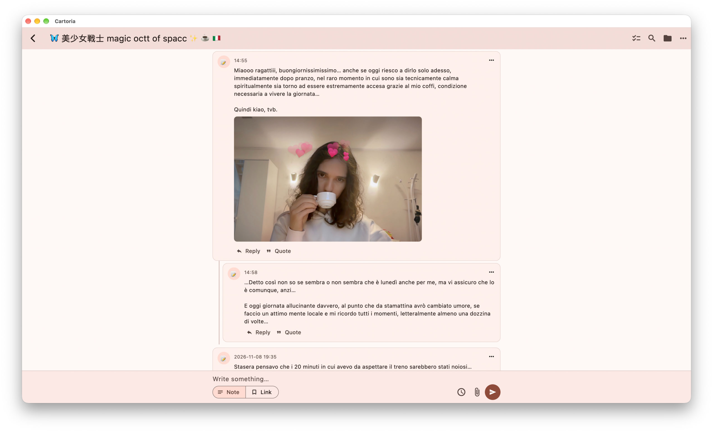

# Cartoria

**A personal archive for notes, bookmarks, and files.**

- **Webapp available: https://hub.octt.eu.org/Cartoria/**
- Latest built releases: https://gitlab.com/octospacc/Cartoria/-/releases/permalink/latest/

<table><tr>
<td><a href="https://gitlab.com/octospacc/Cartoria"><b>GitLab.com</b></a></td>
<td><a href="https://github.com/octospacc/Cartoria">GitHub</a></td>
</tr></table>

Cartoria is a local-first, git-backed personal archive. Everything you write lives as plain HTML and JSON files on your own device — no account, no server, no lock-in. Optional sync to GitHub or GitLab gives you backup, multi-device access, and a browsable history of every change you've ever made.



## What it does

- **Organize into spaces** — separate containers for different topics. Each space holds its own notes, bookmarks, replies, and file attachments.
- **Write notes and save links** — two content types in one feed. Notes are plain text with optional markdown-ish formatting. Bookmarks capture a URL, title, description, and thumbnail from Open Graph metadata.
- **Reply and quote** — thread conversations. Replies nest under their parent with a collapsible preview. Quotes render as inner cards with a reference back to the source post.
- **Attach any file** — images, videos, audio, PDFs, source code. Attachments preview inline; anything else shows as a file row.
- **Import what you already have** — Firefox/Chrome/Safari/Raindrop bookmark HTML exports, Bluesky ATProto CAR archive dumps, and Cartoria's own space zips. All three routes preserve what can be preserved.
- **Trigger webhooks on any post** — HTTP actions fired when a post is created or edited, with a small templating engine for building the request. Telegram reposts, Discord notifications, arbitrary API integrations.
- **Sync to your own git repo** — one or more remotes, per-space scope, offload unused media to save space, restore on demand.
- **Portable, transparent data** — HTML, JSON, and binary files in a directory. `cat` a post, diff a space, open the whole vault in your editor.

## Platform support

| Platform | Status |
|---|---|
| macOS | Full support |
| Windows | Full support |
| Linux | Full support |
| iOS | Full support |
| Android | Full support |
| Web (Chrome, Firefox, Safari) | Supported with caveats — see [Web limitations](#web-limitations) |

## Concepts

| Term | Meaning |
|---|---|
| **Vault** | The entire archive on this device. One per install, backed by one or more sync remotes. |
| **Space** | A themed container for related posts and files. The unit of navigation and export. |
| **Entry** | One post — note, bookmark, or reply. Stored as `<uuid>.html` with a JSON frontmatter block. |
| **Drive** | A space's file collection. Blobs stored alongside metadata, referenced by post attachments. |
| **Hook** | A configured HTTP action triggered by post events. |
| **Sync config** | A single GitHub or GitLab remote with its own scope and settings. |
| **Offloading** | Removing drive blobs from local disk while keeping their metadata. Files fetch on demand from the sync remote. |

## How data is stored

The vault is a plain directory. Every file is human-readable (except drive blobs) and git-friendly.

```
<app-support>/vault/                 ← the vault (per-app-support-dir)
├── settings.json                    ← app preferences (retention, onboarding)
├── sync.json                        ← sync configs (never includes tokens)
└── <space-id>/                      ← one directory per space (UUIDv7)
    ├── space.json                   ← space metadata (name, icon, created)
    ├── entries/
    │   └── <entry-id>.html          ← post body + frontmatter
    ├── drive/
    │   └── <file-id>.<ext>          ← file blobs
    └── drive_meta.json              ← drive file names and timestamps
```

A single entry file looks like:

```html
<!---
{
  "id": "01ja1b2c0-86ca-7457-b9c4-baa15ae069ef",
  "kind": "bookmark",
  "created": "2026-11-08T15:30:00.000Z",
  "url": "https://example.com/article",
  "title": "How to do things",
  "tags": ["read", "tech"],
  "files": ["01ja1bb05-a278-77e9-a8e5-9c0b7f4ddbb9"]
}
--->

<p>Read this article on <a href="https://example.com/article">example.com/article</a>.</p>
```

Every field is meaningful on its own. The frontmatter is valid JSON. The body is plain HTML. Nothing is encoded.

## Getting started

### Prerequisites

- Flutter 3.22 or newer
- For desktop: platform-specific toolchains (Xcode for macOS/iOS, Visual Studio for Windows, GTK for Linux)
- For Android: Android SDK with `compileSdk 34+`
- For web: no additional setup

### Build

```bash
flutter pub get
flutter run -d macos          # or: windows, linux, chrome, ios, android
```

### Release builds

```bash
flutter build macos --release
flutter build windows --release
flutter build linux --release
flutter build apk --release
flutter build ios --release
flutter build web --release
```

For the web target, `--wasm` produces a significantly faster build (2–4× faster execution, smoother scrolling) with automatic fallback to the JavaScript build on browsers without WebAssembly GC support:

```bash
flutter build web --wasm
```

## Importing existing archives

Three import formats are supported. All of them can be reached from the spaces list (top-right icon) or from inside an existing space's overflow menu.

### HTML bookmarks

Netscape-format bookmark exports from Firefox, Chrome, Safari, Raindrop.io, Edge, or any other manager. Folder structure becomes tags. The `ADD_DATE` field is preserved as `createdAt` so backdated imports sort correctly. Duplicate URLs (matching existing bookmarks) are skipped.

### Bluesky CAR exports

Full `app.bsky.feed.post` records from an ATProto repository export, including:
- Reply threading (reconstructed from `reply.parent.uri` and `reply.root.uri`)
- Quote posts (external quotes preserved as semantic `<blockquote>`; own-repo quotes as `quotedPostId` references)
- Image and video attachments (downloaded to the space's drive)
- Link card metadata (URL, title, description, thumbnail)
- Rich-text facets (links expanded, mentions and hashtags preserved as plaintext)

A separate Python script in the repository handles the CAR-to-zip conversion; see `bsky2vault.py` for details.

### Space zips

Cartoria's own export format. Can be imported as a new space (all data preserved) or merged into an existing space (ID-based dedupe, URL-based dedupe for bookmarks, reply chains preserved).

Export modes:
- **Full** — every file including offloaded media re-downloaded from the sync remote
- **On-disk only** — only files currently on this device; references preserved so re-import can fill in missing blobs later
- **Without media** — text only; smallest export, every file appears as missing until restored

## Sync

Sync uses the git forge APIs (GitHub, GitLab, or self-hosted instances) to keep a vault backed up and up to date across devices.

### Configuration

Open the sync screen from the spaces list. Each config specifies:

- **Provider** — GitHub or GitLab, optionally with a custom hostname
- **Owner / repo / branch** — where the data lives
- **Scope** — all spaces, or a specific set
- **Primary flag** — exactly one config is primary; it additionally backs up vault-level data (hooks)
- **Retention** — how many files to keep locally (offloads the rest)

Tokens are stored outside the vault in the OS app-support directory, never synced, never exported.

### What syncs and what doesn't

Synced: spaces, entries, drive blobs, drive metadata, hooks, space metadata.
Not synced: sync configuration itself, tokens, app settings, pre-pull backups.

### Offloading

When retention is set on a sync config, only the N most recent files per space remain on disk. Older files are recorded as "offloaded" and removed from local storage; their bytes fetch on demand from the sync remote when the user opens them. Thumbnails cache separately so the drive view stays fast.

### Pre-pull backups

Before every pull, a snapshot of the current vault is written to the app-support directory (desktop) or the in-browser virtual filesystem (web). Retention is configurable (default 10 desktop, 3 web, 0 disables). Backups can be exported individually for off-device storage; restoring requires manual unzipping over the vault (an in-app restore feature is planned).

## Hooks

Hooks fire HTTP requests on post create or edit. They support:

- **Filters** — space, post kind (note/bookmark), and tag matching
- **Rules** — first matching rule fires; unmatched rules are skipped, allowing one hook to dispatch to different endpoints based on post content
- **Templates** — `{{post.title}}`, `{{vars.bot_token}}`, `{{previous.telegram.json.result.message_id}}`, and more
- **Variables** — named constants shared across rules within a hook
- **Multipart requests** — file uploads from the space's drive, with repeated parts for uploads that scale with post attachments
- **Conditions** — a small expression language on each rule (`post.files.length == 0 && vars.mode == "prod"`)
- **Retries** — a "Retry" button in the hook status dialog, plus automatic retry on transient network failures

### Example: Telegram repost

Two hooks handle the full lifecycle — one to send on create, one to edit the existing message on update:

**Hook A (`tg_send`)** — triggers on create
- Variables: `bot_token`, `chat_id`
- Rule 1: no files → `sendMessage` with `{{post.title || post.body || post.url}}`
- Rule 2: one image → `sendPhoto` with the file attached
- Rule 3: 2–10 images/videos → `sendMediaGroup` as an album
- Rule 4: other → `sendDocument`

**Hook B (`tg_edit`)** — triggers on edit
- Reuses the message ID stored by Hook A: `{{previous.tg_send.json.result.message_id}}`
- Calls `editMessageText` or `editMessageCaption` depending on whether the post has media

Templates, JSON, and manual retries all live in the hook editor. See the hooks section of the app for the full expression reference.

## Web limitations

The web build is fully functional but constrained by browser storage quotas:

- **iOS Safari** caps per-origin storage at ~50 MB and per-tab memory at 200–450 MB. A vault with hundreds of media files needs offloading configured to stay within this budget. The retention setting on sync configs exists primarily for this.
- **PWA splash screen** is fixed to the manifest colors — it cannot follow the system's dark mode setting. This is a Web App Manifest limitation, not a Cartoria one.
- **Browser cleaning tools** can wipe the entire vault (IndexedDB + localStorage). Sync is the only durable protection against this.

Desktop builds have no such limits; a desktop vault can hold gigabytes of attachments comfortably.

## Design notes

### Why plaintext files

A personal archive should outlive the app. If Cartoria disappears tomorrow, a user should still be able to read their notes, recover their bookmarks, and access their files. HTML, JSON, and binary blobs in a directory are the lowest-common-denominator format that any text editor and any future tool can read. Everything from the sync protocol to the export format to the backup system is designed around this invariant.

### Why git for sync

Git provides content-addressed storage, atomic commits, infinite free hosting (via forges), full history, and bidirectional sync — for free. It's also inspectable: a user can `git log` their vault, `git diff` two versions of a note, and `git clone` their data without ever opening the app.

### Why the folder is named `entries/` but the type is `Post`

"Post" is technically accurate — a note is a post, a bookmark is a post, a reply is a post. But the on-disk folder says `entries/` because the UI never says "post". The folder is visible on git; the type is not.

### Why UUIDv7 for IDs

Time-ordered, so directory listings and DB indexes naturally reflect chronological order. Also monotonic within a millisecond under most conditions, which means generated post IDs match the order they were created. Compatible with the same UUIDs generated by the importer.

## Project layout

```
lib/
├── main.dart                       # App entry, theme, navigation
├── data/
│   ├── models.dart                 # Space, Post, DriveFile, etc.
│   ├── store.dart                  # VaultStore — central coordinator
│   ├── app_settings.dart           # Per-vault preferences
│   ├── hooks.dart                  # Hook, HookRule, HookMultipartPart
│   ├── bookmarks.dart              # Netscape bookmark parser
│   ├── space_archive.dart          # Export/import DTOs
│   ├── repos/                      # Filesystem persistence layer
│   │   ├── space_repo.dart
│   │   ├── post_repo.dart
│   │   ├── drive_repo.dart
│   │   ├── hooks_repo.dart
│   │   ├── archive_service.dart
│   │   └── bookmarks_importer.dart
│   ├── services/                   # Stateless domain logic
│   │   ├── hook_executor.dart
│   │   ├── template.dart
│   │   ├── condition.dart
│   │   ├── link_metadata.dart
│   │   └── space_stats.dart
│   └── sync/                       # Git forge sync
│       ├── sync_config.dart
│       ├── sync_service.dart
│       ├── sync_scope.dart
│       ├── github_provider.dart
│       ├── gitlab_provider.dart
│       ├── content_fetcher.dart
│       └── offloaded_store.dart
├── platform/                       # Platform-conditional implementations
│   ├── fs.dart                     # Filesystem (io / web)
│   ├── file_save.dart              # Save / share
│   ├── file_read.dart
│   └── media.dart                  # Video/audio playback URIs
├── ui/
│   ├── screens/                    # Full-screen views
│   └── widgets/                    # Reusable components
└── util/                           # Pure helpers
    ├── html_utils.dart             # Frontmatter, body rendering
    ├── json_format.dart            # Pretty-printed JSON output
    ├── file_category.dart          # MIME-category dispatch
    ├── format.dart                 # Byte formatting
    ├── mime.dart                   # Extension → MIME type
    └── hook_outcome.dart           # Aggregate hook status
```

## Contributing

Issues and pull requests are welcome. A few things worth knowing before opening one:

- The data format is stable; if a change requires a format migration, it must be backward-compatible with existing vaults.
- Files stored in `<vault>/settings.json`, `<vault>/sync.json`, and each space's `<space-id>/space.json` are user-visible. Any change to their schema should be treated as an API change.
- The pull path is memory-sensitive on web. Avoid operations that load all file bytes simultaneously unless they're bounded.
- Prefer extending existing domain services over adding new top-level files. The repo layer owns filesystem access; the store coordinates; the services implement logic; the UI renders.

## Status

Pre-release. The core feature set is stable and dogfooded daily, but expect rough edges around:

- In-app backup restore (currently manual unzipping)
- Web on iOS Safari with media-heavy vaults
- Self-hosted GitLab with path-prefixed installs
